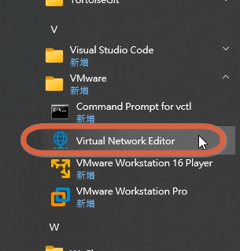
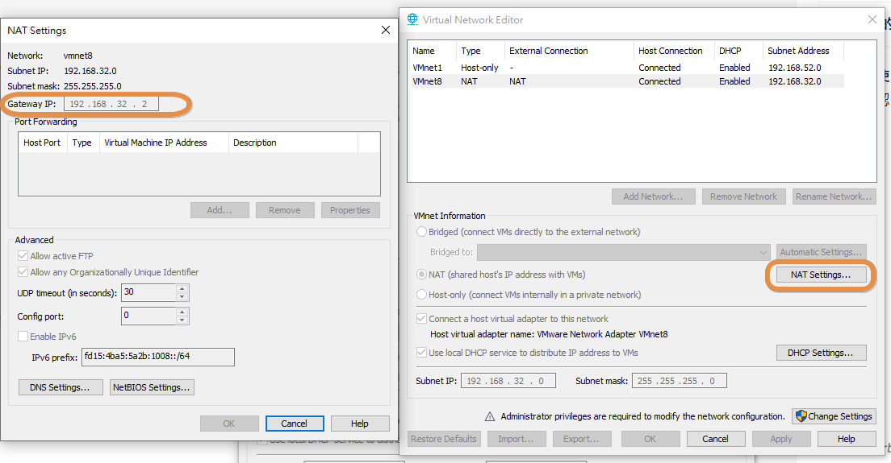

用VMWare 新裝的不能SSH，不能連外網怎麼辦

### **解決方法**
#### **方法 1：手動建立 `ens33` 的 NetworkManager 連線配置**
1. **建立新的連線配置**：
   ```bash
   sudo nmcli connection add type ethernet con-name "ens33-static" ifname ens33 autoconnect yes
   ```
   - `con-name`：自訂連線名稱（例如 `ens33-static`）。
   - `ifname`：指定網路介面名稱（`ens33`）。

2. **設定靜態 IP**：
   ```bash
   sudo nmcli connection modify "ens33-static" ipv4.addresses 192.168.32.128/24
   sudo nmcli connection modify "ens33-static" ipv4.gateway 192.168.32.2
   sudo nmcli connection modify "ens33-static" ipv4.dns "192.168.32.2"
   sudo nmcli connection modify "ens33-static" ipv4.method manual
   ```

3. **啟用連線**：
   ```bash
   sudo nmcli connection up "ens33-static"
   ```

4. **驗證**：
   ```bash
   ip addr show ens33
   ```

---

#### **方法 2：檢查並修復 NetworkManager 偵測問題**
1. **重新偵測網路介面**：
   ```bash
   sudo nmcli device status
   ```
   - 如果 `ens33` 顯示為 `unmanaged`，表示 NetworkManager 未管理它。

2. **強制 NetworkManager 管理 `ens33`**：
   - 編輯 NetworkManager 配置檔案：
     ```bash
     sudo vi /etc/NetworkManager/NetworkManager.conf
     ```
   - 確認 `[ifupdown]` 或 `[keyfile]` 部分未排除 `ens33`，例如：
     ```ini
     [main]
     plugins=ifupdown,keyfile

     [ifupdown]
     managed=true  # 確保此行存在且為 true
     ```

3. **重啟 NetworkManager**：
   ```bash
   sudo systemctl restart NetworkManager
   ```

4. **重新啟用 `ens33`**：
   ```bash
   sudo nmcli device connect ens33
   ```

---

### **驗證是否成功**
1. **檢查 IP 是否分配**：
   ```bash
   ip addr show ens33
   ```
   - 應看到 `inet 192.168.32.128/24`。

2. **測試網路連通性**：
   ```bash
   ping 8.8.8.8
   ```

3. **檢查 NetworkManager 管理狀態**：
   ```bash
   nmcli device status
   ```
   - `ens33` 應顯示為 `connected`。

---

### **如何查詢網關**





